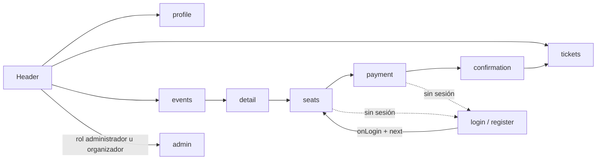

# Arquitectura de componentes y flujo de estado

## 1. Capas

```
main.jsx ─► App.jsx (estado elevado + navegación)
              ├─ pages/        vistas completas; reciben datos y callbacks por props
              │    └─ components/   piezas reutilizables sin conocimiento del negocio
              ├─ hooks/        useAsync · useLocalStorage
              ├─ services/     auth.js (cuentas y sesión simuladas)
              ├─ utils/        funciones puras: asientos, órdenes, formato, validación, API simulada
              └─ data/         events.js (única fuente de verdad de los eventos)
```

Reglas que sigue el código:

- Las **páginas** no leen `localStorage` ni calculan reglas de negocio: reciben props y avisan con callbacks (`onSelectEvent`, `onToggleSeat`, `onPaid`…).
- Los **componentes** son reutilizables y reciben todo por props (`Button`, `Input`, `SeatMap`, `OrderSummary`, `StatusViews`…).
- La lógica de dominio vive en **`utils/`** como funciones puras (`getTakenSeats`, `getEventStatus`, `getSeatsTotal`, `buildOrder`, `validateCard`).
- Todo el estado compartido está **elevado a `App`**: las props bajan, los eventos suben.

## 2. Flujo de navegación

No se usa React Router. `App` guarda `view = { name, params }` y `renderView()` elige la página. Las vistas `seats`, `payment`, `confirmation`, `tickets` y `profile` son protegidas: sin sesión, `navigate()` redirige a `login` y guarda en `params.next` el destino para volver después de iniciar sesión.



Al cambiar de vista, un `useEffect` en `App` sube al inicio de la página, mueve el foco al contenido principal y actualiza el título de la pestaña.

## 3. Mapa de estado

### Estado elevado en `App`

| Estado | Tipo | Persistencia | Quién lo cambia |
|---|---|---|---|
| `view` | `{ name, params }` | No | `navigate()` |
| `user` | `{ id, name, email, role }` o `null` | `localStorage` `et_user` | `handleLogin`, `handleLogout`, `handleUserChange` |
| `cart` | `{ eventId, seats[] }` | `localStorage` `et_cart` | `toggleSeat`, `handlePaid` (lo vacía) |
| `orders` | `Order[]` | `localStorage` `et_orders` | `handlePaid` |
| `cartOpen` | boolean | No | Botón del carrito de `Header` |
| `events` | `Event[]` + `status` (`loading`/`success`/`error`) | No | `useAsync(fetchEvents)` |

### Estado local (por página)

| Página | Estado |
|---|---|
| `EventsPage` | `filters` (texto, fecha, lugar y categoría) |
| `SeatsPage` | `notice` (aviso al superar el máximo de 8 asientos) |
| `PaymentPage` | `method`, `form`, `saveCard`, `errors`, `status` (`idle`/`processing`/`error`), `errorMessage` |
| `ConfirmationPage` | `mailStatus` (envío simulado del boleto) |
| `AuthView` | modo (`login`/`register`/`recover`), campos de cada formulario, `feedback` |
| `ProfileView` | campos editables y mensaje de estado |
| `AdminPage` | pestaña activa, filtros de categoría, estado y rol. Recibe `user`, `events` y `orders` por props; las métricas se derivan con `useMemo` |

### Valores derivados (no se guardan)

| Valor | Cómo se calcula |
|---|---|
| Asientos ocupados | `getTakenSeats(event, orders)`: ocupados de fábrica + asientos de las órdenes |
| Estado del evento (`available`, `soldout`, `past`) | `getEventStatus(event, orders)` |
| Asientos seleccionados | `cart.seats` si `cart.eventId` coincide con el evento |
| Total y resumen por zona | `getSeatsTotal`, `groupSeatsByZone` |
| Cantidad del carrito | `cart.seats.length` |
| Categorías, meses, lugares y eventos filtrados | `useMemo` en `EventsPage` |

### Claves de `localStorage`

| Clave | Contenido | Escribe |
|---|---|---|
| `et_user` | Usuario con sesión | `App` |
| `et_cart` | Carrito | `App` |
| `et_orders` | Órdenes de compra (sin datos de tarjeta) | `App` |
| `easyticket_users` | Usuarios registrados (incluye las cuentas demo) | `services/auth.js` |
| `easyticket_session` | Sesión del módulo de cuentas | `services/auth.js` |

El cierre de sesión limpia `easyticket_session` y `et_user`, y vacía el carrito. Se mantienen dos claves de sesión porque `AuthView` y `ProfileView` (módulo de cuentas) trabajan sobre `services/auth.js`, mientras que `App` guarda el usuario activo con su propio hook; `handleLogin` y `handleUserChange` los mantienen sincronizados.

## 4. Flujo de la compra

1. `SeatsPage` → `SeatMap` → `Seat`: cada clic llama `onToggleSeat(seatId)` y `App.toggleSeat` actualiza `cart` (un solo evento a la vez).
2. `PaymentPage` valida el formulario con `validateCard`. Si hay errores, los muestra y enfoca el primer campo inválido.
3. Con datos válidos llama a `processPayment` (retardo de 1.8 s; una tarjeta terminada en `0000` simula un rechazo). El botón queda bloqueado mientras procesa y un `ref` evita el doble envío.
4. Si el pago pasa, `App.handlePaid` **vuelve a validar** que ningún asiento haya sido vendido mientras tanto, crea la orden con `buildOrder`, la agrega a `orders`, vacía el carrito y navega a `confirmation`.
5. `ConfirmationPage` y `MyTicketsPage` muestran la orden con `TicketCard` (QR generado en el cliente con `qrcode.react`).

   ### Panel de administración y reportes (módulos 7 y 8)

`AdminPage` solo se muestra si `user.role` es `administrador` u `organizador`; con rol de cliente muestra un aviso de acceso restringido. Tiene tres pestañas (`role="tablist"`): **Reportes** (ingresos y ocupación por evento, ventas por categoría y periodo, rendimiento por zona), **Inventario** (eventos con zonas, precios y disponibilidad, filtrables) y **Usuarios** (directorio con roles). Los indicadores y gráficos son valores derivados de `events` + `orders` mediante `useMemo`; no se guardan. Los usuarios se leen de `services/auth.js`.

## 5. Efectos y limpieza

| Efecto | Dependencias | Limpieza |
|---|---|---|
| `App`: scroll, foco y título al cambiar de vista | `[view]` | No requiere |
| `useAsync`: carga de datos | función y reintentos | Bandera de cancelación para no actualizar estado tras desmontar |
| `useLocalStorage`: escritura en `localStorage` (la lectura es la inicialización de `useState`) | `[key, value]` | No requiere; si el almacenamiento falla, la app sigue sin persistir |
| `PaymentPage`: marca de montaje | `[]` | Desmarca al desmontar (no se actualiza estado si el componente ya no está) |
| `EventsPage`: desplazamiento a una sección | `[scrollTo, status]` | No requiere |
| `CartPanel`: cierre con `Escape` | `[open]` | Quita el listener |

## 6. Servicios simulados

| Servicio | Archivo | Comportamiento |
|---|---|---|
| `fetchEvents` | `utils/fakeApi.js` | Retardo de 0.8 s; con `/?fail` falla una vez para mostrar el error y el reintento |
| `processPayment` | `utils/fakeApi.js` | Retardo de 1.8 s; rechaza tarjetas que terminan en `0000` |
| Cuentas y sesión | `services/auth.js` | `registerUser`, `loginUser`, `getActiveSession`, `logoutUser`, `updateUserProfile`, `requestPasswordReset` (1.2 s, no revela si la cuenta existe) |

## 7. Decisiones de diseño

- **Una sola fuente de datos** (`data/events.js`) para listado, detalle, mapa, carrito y boleto, de modo que precios y disponibilidad no se contradicen.
- **Valores derivados en vez de duplicados**: la disponibilidad nunca se guarda; se calcula desde las órdenes.
- **Componentes de estado** (`LoadingState`, `ErrorMessage`, `EmptyState`) compartidos por todas las pantallas para que carga, error y vacío se vean y se comporten igual.
- **Mapa de asientos responsive**: en pantallas menores a 480 px las zonas se apilan para que todos los asientos quepan con un tamaño táctil mínimo de 32 px.
- **Sin datos de tarjeta en las órdenes**: solo se registra el método de pago usado.
